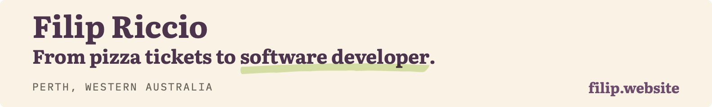

## Hey, I'm Filip

I'm a developer in Perth, Western Australia, finishing a Diploma of IT (Back End Web Development) at [North Metropolitan TAFE](https://www.northmetrotafe.wa.edu.au/).

I got into software because of paper dockets. My family runs a pizza shop, the phone orders were handwritten, and I figured I could do better. That small order taker kept growing into a full point-of-sale system: card payments, Uber Eats orders flowing straight in, a sales dashboard, and an ESP32 dial the kitchen turned to set the wait time. It ran two stores for three years.

These days I mostly build things because I want them to exist:

- **Postie**: an e-ink reader that pulls blog posts from RSS feeds, with a SvelteKit back end on my home server
- **Tino's Pizza POS**: the point of sale above, built with SvelteKit, PostgreSQL and Stripe Terminal
- **Live Works**: a Laravel app our TAFE team is building so lecturers can archive and redeploy student projects

I like delightful interfaces, back ends, databases, self-hosting, and anything with a microcontroller in it.

I'm looking for a **junior developer role or internship in Perth from December 2026**. You can see more on [my website](https://filip.website), or find me on [LinkedIn](https://www.linkedin.com/in/filip-riccio).

<!-- TODO: Link the project names to their repositories or write-ups once they're published. -->
